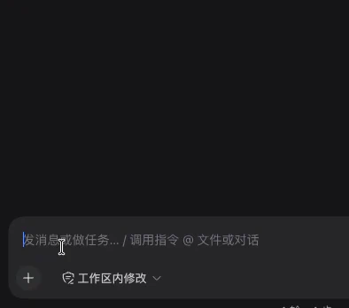
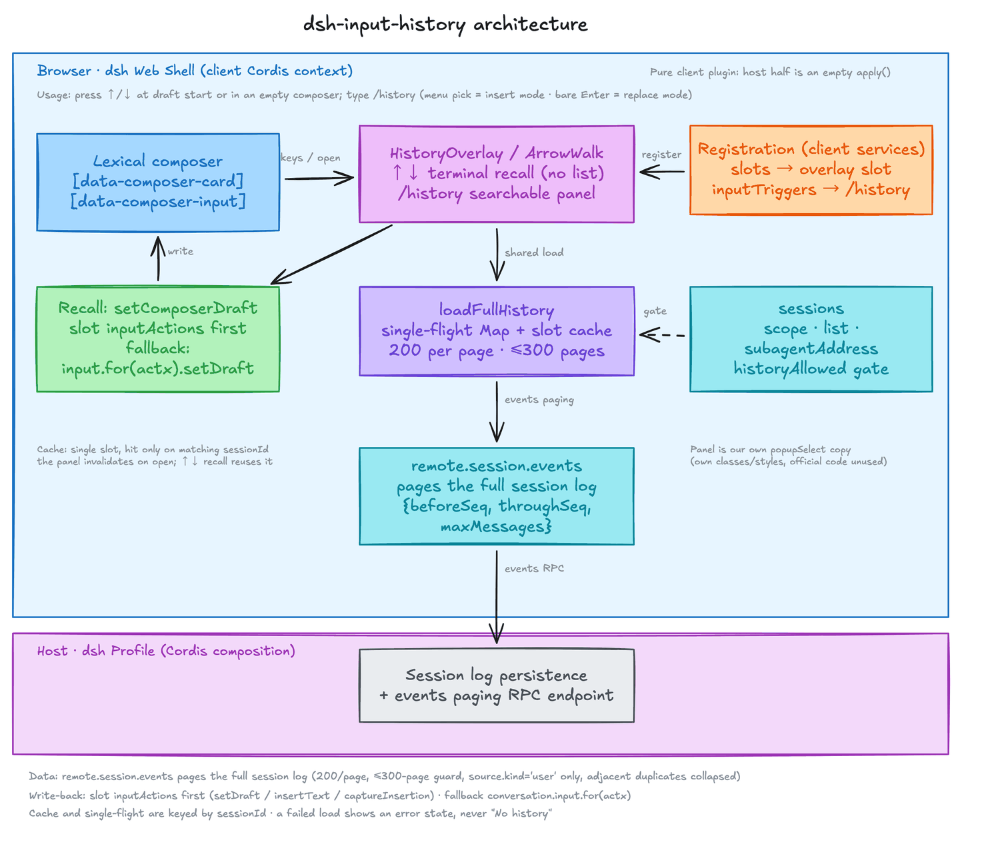

<h1 align="center">dsh-input-history</h1>

<p align="center">
  <a href="README.md">简体中文</a> · <strong>English</strong>
</p>

<p align="center">
  <a href="https://github.com/topics/dsh-plugin"></a>
  <a href="https://opensource.org/licenses/MIT"></a>
  <a href="https://www.npmjs.com/package/@deepseek-ai/dsh">=0.2.2-rc.2" src="https://img.shields.io/badge/dsh-%3E%3D0.2.2--rc.2-4d6bfe?style=flat" /></a>
</p>

<p align="center">
  <strong>Terminal-style input history: press <kbd>↑</kbd>/<kbd>↓</kbd> to browse messages sent in the current session.</strong><br>
  Pure client-side plugin, no host changes — the <code>/history</code> command opens a searchable history panel.
</p>

## 🎬 Demo

<p align="center">
  
</p>

## ✨ Features

The plugin injects two complementary recall channels into every session:

- **⌨️ Terminal-style arrow recall** — like shell history, with **no popup list**: <kbd>↑</kbd>/<kbd>↓</kbd> directly replace the composer content
- **📋 `/history` panel** — a searchable floating list, browsable with mouse or keyboard

### ⌨️ Arrow-key recall

| Action | Effect |
|---|---|
| <kbd>↑</kbd> / <kbd>↓</kbd> (empty composer, or caret at the very start) | Starts recall; fetches the most recent sent message |
| <kbd>Esc</kbd> | Restores the draft and exits recall |

### 📋 `/history` panel

| Way | Recall semantics |
|---|---|
| Pick `/history` in the slash menu | **Insert mode**: the message is inserted at the `/history` token, keeping surrounding text |

The panel supports **search filtering**, mouse clicking, and <kbd>↑</kbd>/<kbd>↓</kbd> + <kbd>Enter</kbd>; <kbd>Esc</kbd> or clicking outside cancels.

> History is read from the current session's full log (paged), strictly isolated per session; adjacent duplicate messages are collapsed automatically.

## 🚀 Install
From NPM (DSH `>=0.2.2-rc.2`):
```
dsh plugin --profile web add @loommii/dsh-input-history@0.4.0
```

Or from GitHub:

```
dsh plugin --profile web add github:loommii/dsh-input-history
```

> After installation, the plugin list shows **Input History (@loommii/dsh-input-history)**.

### DSH compatibility

Starting with `0.4.0`, this plugin supports only DSH `>=0.2.2-rc.2`. It uses the current public `conversation.input.for()`, `remote.session.events`, `sessions`, `slots` (including `inputActions`), and `inputTriggers` APIs and keeps no compatibility branches for older releases.

| DSH version | Status | Notes |
|---|---|---|
| `>=0.2.2-rc.2` | ✅ Supported | Minimum for 0.4.0; developed and verified against `0.2.2-rc.2` |
| `0.2.2-rc.3` | ✅ Supported | Latest release candidate (npm `next` tag); checked package by package against its published artifacts — the APIs this plugin uses are identical to `0.2.2-rc.2`; the GUI verification baseline is still `0.2.2-rc.2` |
| `<0.2.2-rc.2` | ❌ Unsupported | Keep using `0.3.1`, the last release compatible with `0.1.7-rc.1+` |

Breaking changes in `0.4.0`:

- The minimum DSH version rises from `0.1.7-rc.1` to `0.2.2-rc.2`
- Old-version compatibility code was removed: the unused bare `remote` service injection, legacy service-shape probes, and legacy theme-token fallbacks
- Uses `remote.session.events` (`page` is deprecated) plus the slot's `inputActions` / `captureInsertion()` / `insertText()`, removing the DOM caret walker and the `RuntimeDraft` mirror
- Functionality is unchanged; the menu-pick path keeps the `/history` token until a history row is chosen, then replaces only that token while preserving surrounding content and undo history

> npm's `latest` currently points at `0.2.2-rc.1` and `next` at `0.2.2-rc.3` (`0.2.2-rc.2` no longer sits under any tag, so spell the version out); pin the version explicitly when installing DSH. Reload the page after upgrading DSH.

For a DSH version older than `0.2.2-rc.2`, keep using `0.3.1`:

```
dsh plugin --profile web add @loommii/dsh-input-history@0.3.1
```

Restart the profile after installing (`dsh web` / `dsh --profile <name>`).

Upgrade / uninstall:

```
dsh plugin --profile web update @loommii/dsh-input-history
dsh plugin --profile web remove @loommii/dsh-input-history
```

## 💡 Usage

Focus the chat composer of any session:

- With an **empty composer**, press <kbd>↑</kbd>/<kbd>↓</kbd>, or move the caret to the **very start** and press <kbd>↑</kbd>: terminal-style recall begins.
- Type <code>/history</code> and pick it in the slash menu, or press Enter on the bare command: the history panel opens.

## 🏗️ Architecture

The plugin is pure client-side UI: history is paged through `remote.session.events` from the host's full session log (cache isolated per session), and recall writes through the slot's `inputActions` (`setDraft` / `insertText`), falling back to `conversation.input.for(actx)` for source callbacks.

<p align="center">
  
</p>

## 📄 License

MIT
