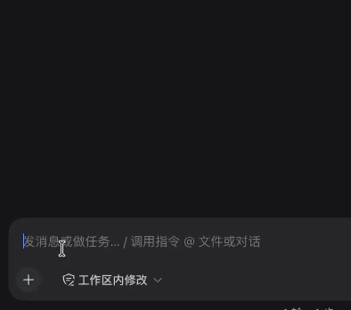
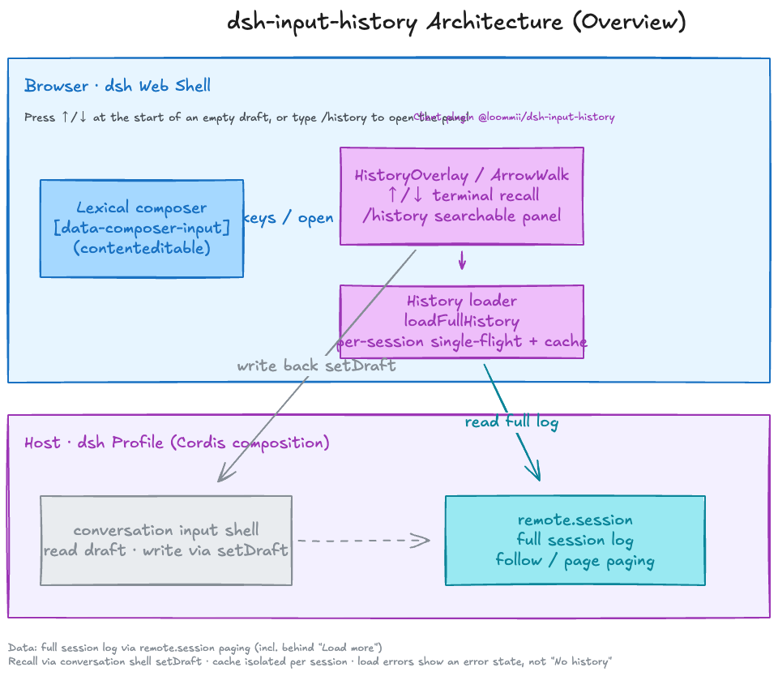

<h1 align="center">dsh-input-history</h1>

<p align="center">
  <a href="README.md">简体中文</a> · <strong>English</strong>
</p>

<p align="center">
  <a href="https://github.com/topics/dsh-plugin"></a>
  <a href="https://opensource.org/licenses/MIT"></a>
  <a href="https://www.npmjs.com/package/@deepseek-ai/dsh">=0.1.7-rc.1" src="https://img.shields.io/badge/dsh-%3E%3D0.1.7--rc.1-4d6bfe?style=flat" /></a>
</p>

<p align="center">
  <strong>Terminal-style input history: press <kbd>↑</kbd>/<kbd>↓</kbd> to browse messages sent in the current session.</strong><br>
  Pure client-side plugin, no host changes — the <code>/history</code> command opens a searchable history panel.
</p>

## 🎬 Demo

<p align="center">
  
</p>

## ✨ Features

The plugin injects two complementary recall channels into every session:

- **⌨️ Terminal-style arrow recall** — like shell history, with **no popup list**: <kbd>↑</kbd>/<kbd>↓</kbd> directly replace the composer content
- **📋 `/history` panel** — a searchable floating list, browsable with mouse or keyboard

### ⌨️ Arrow-key recall

| Action | Effect |
|---|---|
| <kbd>↑</kbd> / <kbd>↓</kbd> (empty composer, or caret at the very start) | Starts recall; fetches the most recent sent message |
| <kbd>Esc</kbd> | Restores the draft and exits recall |

### 📋 `/history` panel

| Way | Recall semantics |
|---|---|
| Pick `/history` in the slash menu | **Insert mode**: the message is inserted at the `/history` token, keeping surrounding text |

The panel supports **search filtering**, mouse clicking, and <kbd>↑</kbd>/<kbd>↓</kbd> + <kbd>Enter</kbd>; <kbd>Esc</kbd> or clicking outside cancels.

> History is read from the current session's full log (paged), strictly isolated per session; adjacent duplicate messages are collapsed automatically.

## 🚀 Install
From NPM (DSH `>=0.1.7-rc.1`, no upper bound):
```
dsh plugin --profile web add @loommii/dsh-input-history@0.3.1
```

Or from GitHub:

```
dsh plugin --profile web add github:loommii/dsh-input-history
```

### DSH compatibility

`0.3.1` uses the public `conversation.input.for()` input API and supports DSH `0.1.7-rc.1` and every newer release (including the `0.2.x` prereleases).

| DSH version | Status | Notes |
|---|---|---|
| `0.2.1-rc.2` (current prerelease) | ✅ Audited, no code change needed | All 7 releases between `0.2.0-rc.2` and `0.2.1-rc.2` plus 16 plugin API packages were compared; none of the 10 contracts this plugin uses changed incompatibly |
| `0.2.0-rc.2` | ✅ Verified | Development baseline of 0.3.1 |
| `0.1.7-rc.1` ~ `0.2.0-rc.1` | ✅ Compatible | Same public input / session contracts |
| `< 0.1.7-rc.1` | ❌ Incompatible | Use `0.1.2` instead |

Plugin-facing changes from `0.2.0-rc.2` to `0.2.1-rc.2`, none of which affect this plugin:

- Compatibility is now decided by `engines.dsh` when present (this package declares `>=0.1.7-rc.1`, which covers `0.2.1-rc.2`; verified)
- The runtime invariant plugins and every package's `./invariant` export were removed (unused here)
- The `conversation.session` injection face renamed `bindDraftMirror` → `bindDraftPersistence` (this plugin does not occupy that slot)
- Command tokens became atomic chips and drafts are persisted as structured snapshots: `setDraft(text)` keeps its signature, with the semantics narrowed to "replace with plain text", matching history recall

> After upgrading to `0.2.1-rc.2`, **reload the page**: the new release gates the client module graph per Host release, so an open page never hot-swaps to another release's plugins. Note that npm's `latest` still points at `0.2.0-rc.2` while `0.2.1-rc.2` sits under `next`; pin the version explicitly when installing.
> These conclusions come from static comparison. After upgrading, confirm the three boundary cases with the regular regression checklist: `/history` token consumption after command chips, history reads under a non-owner peer, and first reads of sessions created on `0.2.0`.

For a DSH version older than `0.1.7-rc.1`, install the last old-compatible tagged release (`v0.1.2`):

```
dsh plugin --profile web add @loommii/dsh-input-history@0.1.2
```

Restart the profile after installing (`dsh web` / `dsh --profile <name>`).

Upgrade / uninstall:

```
dsh plugin --profile web update @loommii/dsh-input-history
dsh plugin --profile web remove @loommii/dsh-input-history
```

## 💡 Usage

Focus the chat composer of any session:

- With an **empty composer**, press <kbd>↑</kbd>/<kbd>↓</kbd>, or move the caret to the **very start** and press <kbd>↑</kbd>: terminal-style recall begins.
- Type <code>/history</code> and pick it in the slash menu, or press Enter on the bare command: the history panel opens.

## 🏗️ Architecture

The plugin is pure client-side UI: history is paged from the host's `remote.session` full session log (cache isolated per session), and recall is written through the public `conversation.input.for(actx).setDraft()` API.

<p align="center">
  
</p>

## 📄 License

MIT
