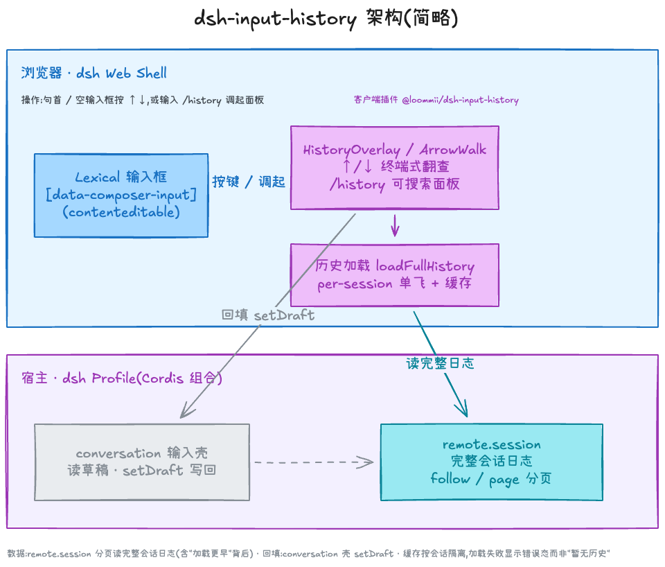

<h1 align="center">dsh-input-history</h1>

<p align="center">
  <strong>简体中文</strong> · <a href="README.en.md">English</a>
</p>

<p align="center">
  <a href="https://github.com/topics/dsh-plugin"></a>
  <a href="https://opensource.org/licenses/MIT"></a>
  <a href="https://www.npmjs.com/package/@deepseek-ai/dsh">=0.1.7-rc.1" src="https://img.shields.io/badge/dsh-%3E%3D0.1.7--rc.1-4d6bfe?style=flat" /></a>
</p>

<p align="center">
  <strong>终端式输入历史，用 <kbd>↑</kbd>/<kbd>↓</kbd> 翻查本会话发过的消息。</strong><br>
  纯客户端插件，无宿主侧改动 — <code>/history</code> 指令提供可搜索的历史面板。
</p>

## 🎬 演示

<p align="center">
  
</p>

## ✨ 功能

本插件给每个会话注入两条互补的输入历史召回通道：

- **⌨️ 终端式方向键翻查** — 仿 shell 命令历史，**不弹列表**，<kbd>↑</kbd>/<kbd>↓</kbd> 直接替换输入框内容
- **📋 `/history` 历史面板** — 可搜索的悬浮列表，支持鼠标点选与键盘操作

### ⌨️ 方向键翻查

| 操作 | 效果 |
|---|---|
| <kbd>↑</kbd> / <kbd>↓</kbd>（空输入框或光标在最前） | 开始翻查，取回最近一条已发送消息 |
| <kbd>Esc</kbd> | 还原草稿并退出翻查 |

### 📋 `/history` 面板

| 方式 | 召回语义 |
|---|---|
| 斜杠菜单选中 `/history` | **插入模式**：消息插入到 `/history` 词元位置，前后文保留 |

面板支持**搜索过滤**、鼠标点选与 <kbd>↑</kbd>/<kbd>↓</kbd> + <kbd>Enter</kbd> 操作；<kbd>Esc</kbd> 或点击面板外取消。

> 数据读取自当前会话的完整日志（含分页），按会话严格隔离；相邻重复消息自动折叠。

## 🚀 安装
从 NPM 安装（DSH `>=0.1.7-rc.1`，无上限）：
```
dsh plugin --profile web add @loommii/dsh-input-history@0.3.1
```

或从 GitHub 安装：

```
dsh plugin --profile web add github:loommii/dsh-input-history
```

### DSH 版本兼容

`0.3.1` 使用 DSH 的公开 `conversation.input.for()` 输入接口，支持 DSH `0.1.7-rc.1` 及以上的所有版本（含 `0.2.x` 预发布）。

| DSH 版本 | 状态 | 说明 |
|---|---|---|
| `0.2.1-rc.2`（当前最新预发布） | ✅ 已审计，无需改代码 | 逐版本比对 `0.2.0-rc.2 → 0.2.1-rc.2` 的 7 个发布与 16 个插件 API 包，本插件使用的 10 条契约无破坏性变更 |
| `0.2.0-rc.2` | ✅ 已验证 | 0.3.1 的开发基线 |
| `0.1.7-rc.1` ~ `0.2.0-rc.1` | ✅ 兼容 | 同一套公开输入 / 会话接口 |
| `< 0.1.7-rc.1` | ❌ 不兼容 | 请改用 `0.1.2` |

`0.2.1-rc.2` 相对 `0.2.0-rc.2` 的插件面变更（均不影响本插件）：

- 插件兼容性判定改为优先读 `engines.dsh`（本插件 `>=0.1.7-rc.1` 覆盖 `0.2.1-rc.2`，实测通过）
- 移除运行时 invariant 插件及各包 `./invariant` 导出（本插件不使用）
- `conversation.session` 注入面 `bindDraftMirror` → `bindDraftPersistence`（本插件不占用该槽位）
- 命令词元 chip 化与草稿结构化持久化：`setDraft(text)` 签名不变，语义收敛为「替换为纯文本」，与历史回填行为一致

> 升级 DSH 到 `0.2.1-rc.2` 后请**整页刷新** GUI —— 新版本对跨 release 的客户端模块图做了门控，已打开的页面不会热切换到新 release 的插件。另外 npm 的 `latest` 仍指向 `0.2.0-rc.2`，`0.2.1-rc.2` 位于 `next` 标签下，升级时请显式指定版本。
> 上述兼容结论来自静态比对，建议升级后按标准回归用例确认三个边界场景：命令 chip 化后 `/history` 的词元消费、非 owner peer 下的历史读取、`0.2.0` 时代旧会话的首读。

如果你的 DSH 早于 `0.1.7-rc.1`，请安装旧兼容版本（当前仓库最后一个旧兼容 tag 为 `v0.1.2`）：

```
dsh plugin --profile web add @loommii/dsh-input-history@0.1.2
```

安装后重启 profile（`dsh web` / `dsh --profile <name>`）。

升级 / 卸载：

```
dsh plugin --profile web update @loommii/dsh-input-history
dsh plugin --profile web remove @loommii/dsh-input-history
```

## 💡 使用

聚焦任意会话的聊天输入框：

- **空输入框**按 <kbd>↑</kbd>/<kbd>↓</kbd>，或光标移到**最前**按 <kbd>↑</kbd>：开始终端式翻查。
- 输入 <code>/history</code> 并从斜杠菜单选中，或直接回车：打开历史面板。


## 🏗️ 架构

本插件是纯客户端 UI：历史从宿主 `remote.session` 完整会话日志分页读取（按会话隔离缓存），回填通过公开的 `conversation.input.for(actx).setDraft()` 完成。

<p align="center">
  
</p>


## 📄 许可

MIT
